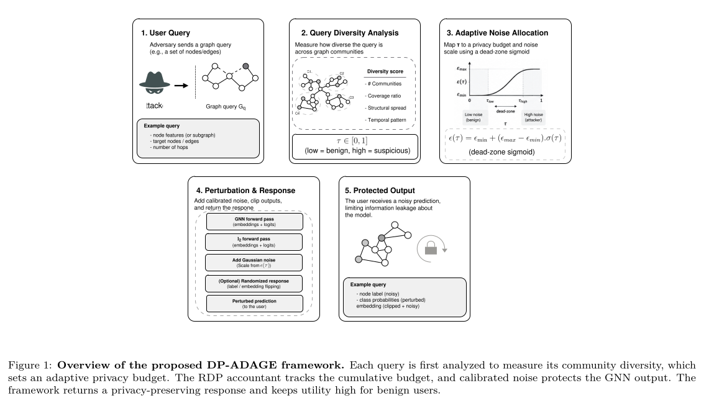

# DP-ADAGE: Differentially Private Active Defenses Against GNN Extraction

<div align="center">

[](https://www.python.org/downloads/)
[](https://pytorch.org/)
<a href="https://drive.google.com/file/d/1YrSofdLSYjfFnO5jCF0VzeavdsMxf13a/view?usp=sharing" target="_blank"></a>
[](https://opensource.org/licenses/MIT)
[](https://arxiv.org/)

**Jamal Boussouf · Ibrahim Ouahbi · Khalid El Makkaoui**  
*University Mohammed First, Oujda, Morocco*

</div>

---

> **DP-ADAGE** is the **first GNN inference-time defense** that combines community-aware query-diversity tracking with a provable **Rényi Differential Privacy (RDP)** guarantee against model extraction attacks. It drives attacker surrogate accuracy to near-random-guess levels (avg. **34.5%** across 5 benchmarks, a **45.4 percentage point reduction** from 79.9% undefended) while preserving benign user accuracy within **0.1 percentage points** of the undefended baseline (80.5% vs. 80.6%).

---

## Paper

**"DP-ADAGE: Differentially Private Active Defenses Against GNN Extraction"**  
Submitted to *Elsevier* — preprint available.

> **TL;DR**: Graph Neural Networks deployed as cloud APIs are vulnerable to model extraction attacks. DP-ADAGE wraps any GNN API with four sequential components — a CommunityTracker, a BudgetAllocator, an RDPAccountant, and a Perturbation Mechanism — to deliver an auditable (ε\*, δ)-DP certificate for the entire query session without sacrificing benign utility.

<p align="center">
  
</p>

---

## System Overview

```
Incoming Query (user u, node v)
         │
         ▼
┌─────────────────────┐
│  CommunityTracker   │  ← Louvain offline partition; per-user τ = |O_u| / K
└────────┬────────────┘
         │  τ (query diversity score)
         ▼
┌─────────────────────┐
│   BudgetAllocator   │  ← Dead-zone sigmoid: τ → ε(τ) per-query RDP budget
└────────┬────────────┘
         │  ε(τ)
         ▼
┌─────────────────────┐
│    RDPAccountant    │  ← Additive composition; hard cap ε_total; noise floor
└────────┬────────────┘
         │  ε_q (clamped)
         ▼
┌─────────────────────┐
│   Victim GNN +      │  ← Output clipping (ℓ₂-norm ≤ B or C)
│ Perturbation Mech.  │    + Randomized Response (labels) or Gaussian (embeddings)
└────────┬────────────┘
         │
         ▼
   Differentially Private Response
```

### Key Components

| Component | File | Description |
|-----------|------|-------------|
| `CommunityTracker` | [`src/community_tracker.py`](src/community_tracker.py) | Louvain community detection; maintains per-user set O_u; computes τ = \|O_u\| / K |
| `BudgetAllocator` | [`src/budget_allocator.py`](src/budget_allocator.py) | Dead-zone sigmoid: ε(τ) = ε_max (if τ ≤ τ_dead) or ε_max + (ε_0 − ε_max)·g̃(τ) |
| `RDPAccountant` | [`src/rdp_accountant.py`](src/rdp_accountant.py) | Additive RDP composition; enforces ε_total cap; triggers noise floor |
| `Perturbation` | [`src/perturbation.py`](src/perturbation.py) | Randomized Response for logits; Gaussian mechanism (σ = √(α·Δ₂²/2ε_q)) for embeddings |
| `DP-ADAGE Pipeline` | [`src/dp_adage.py`](src/dp_adage.py) | Full query-response protocol (Algorithm 1 in the paper) |

---

## Project Structure

```
DP-ADAGE-V2/
├── README.md
├── requirements.txt
│
├── src/                              # Core system implementation
│   ├── __init__.py
│   ├── community_tracker.py          # CommunityTracker: Louvain + τ score
│   ├── budget_allocator.py           # BudgetAllocator: dead-zone sigmoid
│   ├── rdp_accountant.py             # RDPAccountant: composition + hard cap
│   ├── perturbation.py               # Gaussian / Randomized Response mechanism
│   ├── dp_adage.py                   # Full DP-ADAGE pipeline (Algorithm 1)
│   ├── adage_baseline.py             # Original ADAGE heuristic defense
│   ├── dawn_baseline.py              # DAWN watermarking baseline
│   ├── prada_baseline.py             # PRADA rate-limiting baseline
│   ├── gnn_models.py                 # GCN, GAT, GraphSAGE, GIN, GraphTransformer
│   ├── attacker.py                   # Surrogate model + extraction attack logic
│   └── utils.py                      # Helpers, metrics, dataset loading
│
├── experiments/                      # Reproducible experiment scripts
│   ├── exp_main_results.py           # Main defense comparison → Table 2
│   ├── exp_ablation_budget.py        # Ablation on ε_total → Table 3 / Fig 6
│   ├── exp_adaptive_attacker.py      # Adaptive attacker evaluation → Table 5 / Sec 6.9
│   ├── exp_large_scale.py            # Scalability on Flickr → Table 6 / Sec 6.10
│   ├── exp_kl_divergence.py          # KL divergence bound validation
│   ├── exp_cross_dataset.py          # Cross-dataset generalization
│   ├── exp_profiling.py              # Latency & throughput profiling → Table 7 / Sec 6.11
│   ├── run_all_datasets.py           # Driver: all 5 datasets × all defenses
│   └── _validate_benign.py           # Benign user utility validation
│
├── visuals/                          # Figure generation (→ PDF output)
│   ├── plot_main_results.py          # Fig 2: surrogate acc + budget trajectory
│   ├── plot_pareto.py                # Fig 7: Pareto trilemma scatter
│   ├── plot_all_results.py           # All-dataset comparison
│   └── outputs/                      # Generated PDFs
│       ├── fig2_main_results.pdf
│       ├── fig3_pareto.pdf
│       └── fig7_radar.pdf
│
└── data/                             # Experimental results & configuration
    ├── results_all_datasets.csv      # Main results: 5 datasets × 6 defenses × 5 seeds (Table 2)
    ├── results_main_cora.csv         # Detailed Cora trajectory (per-query, Fig 5)
    ├── results_ablation_budget.csv   # Budget ablation (ε_total ∈ {1, 10, 200}, Table 3)
    ├── results_adaptive_attacker.csv # Adaptive attacker (uncertainty + budget-aware, Table 5)
    ├── results_large_scale.csv       # Flickr scalability results (Table 6)
    ├── results_profiling.csv         # Profiling memory & throughput (Sec 6.11)
    ├── p_values_table1.csv           # Statistical significance (Table 4)
    └── config_default.json           # Default hyperparameter configuration (Table 1)
```

---

## Quick Start

> [](https://drive.google.com/file/d/1YrSofdLSYjfFnO5jCF0VzeavdsMxf13a/view?usp=sharing) &nbsp; **Try it instantly in your browser** — no local setup required.

### 1. Install dependencies

```bash
pip install -r requirements.txt
```

> **Note on PyG extensions**: `torch-scatter` and `torch-sparse` are optional. Install precompiled wheels matching your PyTorch/CUDA version from the [PyG installation guide](https://pytorch-geometric.readthedocs.io/en/latest/install/installation.html).

### 2. Run the main experiment (Table 2 — all 5 datasets)

```bash
python experiments/run_all_datasets.py
# Results saved to data/results_all_datasets.csv
```

### 3. Run a single dataset experiment

```bash
python experiments/exp_main_results.py --dataset Cora --seeds 5
```

### 4. Ablation study (ε_total sensitivity)

```bash
python experiments/exp_ablation_budget.py
```

### 5. Adaptive attacker evaluation

```bash
python experiments/exp_adaptive_attacker.py
```

### 6. Generate all figures (PDF)

```bash
python visuals/plot_main_results.py
python visuals/plot_pareto.py
python visuals/plot_all_results.py
```

### 7. Interactive notebook

```bash
jupyter notebook RUN.ipynb
```

---

## Configuration

Default hyperparameters ([`data/config_default.json`](data/config_default.json) and **Table 1** in the paper):

| Group | Parameter | Value | Description |
|---|---|---|---|
| **Defense** | `epsilon_0` ($\varepsilon_0$) | 0.01 | Strict privacy floor — max noise (adversaries at budget cap) |
| | `epsilon_max` ($\varepsilon_{\max}$) | 10.0 | Relaxed per-query budget — min noise (benign users in dead zone) |
| | `epsilon_total` ($\varepsilon_{\text{total}}$) | 200.0 | Hard session budget cap (evaluated at 1.0, 10.0, and 200.0 in ablation) |
| | `k` ($k_{\text{sharp}}$) | 10.0 | Sigmoid steepness of the budget allocator (Eq. 7 uses 20.0) |
| | `tau_0` ($\tau_0$) | 0.20 | Sigmoid midpoint / inflection point (Eq. 7 uses 0.30) |
| | `tau_dead` ($\tau_{\text{dead}}$) | 0.05 | Dead-zone diversity threshold — below this, $\varepsilon(\tau) = \varepsilon_{\max}$ |
| | `alpha` ($\alpha$) | 8 | RDP order $\alpha$ |
| | `delta` ($\delta$) | $10^{-6}$ | DP failure probability $\delta$ |
| **Clipping & Output** | `clip_C` ($C$) | 1.0 | Logit clipping norm $C$ |
| | `clip_B` ($B$) | 1.0 | Embedding clipping norm $B$ |
| | `output_type` | logits | Output interface (discrete labels via Randomized Response; embeddings via Gaussian) |
| **Communities** | `num_communities` ($K$) | 10 | Target number of Louvain communities $K$ |
| **Victim Model** | Architecture | GCN | 2-layer GCN with 64 hidden units |
| | Training | 200 epochs | Adam optimizer, lr = 0.01, weight decay = $5 \times 10^{-4}$, dropout = 0.5 |
| **Attacker** | Architecture | GCN | 2-layer GCN with 64 hidden units (surrogate) |
| | Query Strategy | Uncertainty | Uncertainty sampling (100 for Cora case study & Flickr, 200 main, 500 adaptive) |
| **Data & Protocol** | Splits | 80 / 10 / 10 | Train / validation / test node split |
| | Repetitions | 5 seeds | Seeds 42–46 (single run for Flickr, latency, and profiling) |

> **Choosing $\varepsilon_{\text{total}}$**: For a *meaningful* formal certificate (Proposition 3.2 in the paper), use a single-digit $\varepsilon_{\text{total}}$ (e.g., $\varepsilon_{\text{total}} = 1.0 \implies \varepsilon^* \approx 2.97$, or $\varepsilon_{\text{total}} = 8.0 \implies \varepsilon^* \approx 9.97$). The $\varepsilon_{\text{total}} = 200.0$ default represents a **high-availability configuration** that stress-tests the defense across long query sessions; it remains mathematically valid under RDP composition, but the converted $(\varepsilon^*, \delta)$-DP bound is loose.

---

## Formal Privacy Guarantee

For any user issuing $T$ queries, the full interaction transcript satisfies **$(\varepsilon^*, \delta)$-DP** where:

$$\varepsilon^* = \varepsilon_{\text{total}} + \frac{\log(1/\delta)}{\alpha - 1}$$

**Concrete certificate values** (with $\alpha = 8, \delta = 10^{-6}$, where $\frac{\log(1/\delta)}{\alpha - 1} = \frac{\log(10^6)}{7} \approx 1.973$):
- **Strict certificate** ($\varepsilon_{\text{total}} = 1.0$): $\varepsilon^* \approx 2.97$
- **Moderate certificate** ($\varepsilon_{\text{total}} = 8.0$): $\varepsilon^* \approx 9.97$
- **Balanced certificate** ($\varepsilon_{\text{total}} = 10.0$): $\varepsilon^* \approx 11.97$
- **High-availability configuration** ($\varepsilon_{\text{total}} = 200.0$): $\varepsilon^* \approx 201.97$

This guarantee is established by four formal results in Section 4 of the paper:

| Theorem / Proposition | Statement |
|---|---|
| **Theorem 4.1** | Per-query $(\alpha, \varepsilon_q)$-RDP via calibrated Gaussian mechanism ($\sigma = \sqrt{\alpha \Delta_2^2 / 2\varepsilon_q}$) |
| **Theorem 4.2** | Cumulative $(\alpha, \sum \varepsilon_q)$-RDP via additive RDP composition across query sequence |
| **Corollary 4.3** | Hard budget cap: $\varepsilon_{\text{cum}, u} \le \varepsilon_{\text{total}}$ for all users $u$ regardless of session length $T$ |
| **Theorem 4.4** | Final $(\varepsilon^*, \delta)$-DP certificate via RDP-to-DP conversion |
| **Proposition 4.5** | Monotone noise scale: noise scale $\sigma_\tau$ is strictly decreasing in $\varepsilon_q$, hence strictly increasing in query diversity $\tau$ |

The noise floor mechanism guarantees that once $\varepsilon_{\text{cum}, u} = \varepsilon_{\text{total}}$ (i.e., remaining budget $\varepsilon_q = 0$), **every subsequent response returns a query-independent output**:
- **Logits / Labels**: Draws a uniform random label from $\{1, \dots, |C|\}$ via Randomized Response ($\rho(0) = 1$).
- **Embeddings**: Emits a fixed offline reference vector $\mathbf{e}_{\text{ref}}$ (e.g., zero vector or precomputed mean clipped embedding).
This renders further extraction mathematically impossible regardless of adversary strategy.

---

## Key Results (Table 2 in Paper)

Main experimental comparison evaluated across **5 datasets** and **6 defenses**, averaged over **5 random seeds** (seeds 42–46) at **200 attacker queries** with session cap $\varepsilon_{\text{total}} = 200.0$.

### Complete Per-Dataset Results (Table 2)

| Dataset | Defense | Benign Acc. (%) | Att. Surr. Acc. (%) | Att. Fid. (%) | Budget Consumed | Final $\tau$ |
|:---|:---|:---:|:---:|:---:|:---:|:---:|
| **Cora** | NoDefense | 80.6 ± 0.6 | 80.5 ± 0.7 | 91.5 ± 0.5 | N/A | 0.000 |
| | StaticNoise | 80.5 ± 0.5 | 80.6 ± 0.9 | 91.7 ± 0.8 | N/A | 0.000 |
| | OriginalADAGE | 80.6 ± 0.6 | 70.7 ± 2.8 | 77.2 ± 2.4 | N/A | 0.626 ± 0.056 |
| | PRADA | 80.6 ± 0.6 | 65.3 ± 2.2 | 71.6 ± 2.7 | N/A | 0.000 |
| | DAWN | 77.7 ± 0.3 | 80.5 ± 0.9 | 90.0 ± 0.7 | N/A | 0.000 |
| | **DP-ADAGE** | **80.6 ± 0.6** | **26.2 ± 4.2** | **26.1 ± 4.4** | **200.0 ± 0.0** | **0.656 ± 0.020** |
| **Citeseer** | NoDefense | 71.3 ± 0.3 | 71.4 ± 0.7 | 87.6 ± 1.1 | N/A | 0.000 |
| | StaticNoise | 71.2 ± 0.4 | 71.3 ± 1.1 | 86.7 ± 1.7 | N/A | 0.000 |
| | OriginalADAGE | 71.3 ± 0.3 | 70.5 ± 0.4 | 87.2 ± 0.5 | N/A | 0.303 ± 0.007 |
| | PRADA | 71.3 ± 0.3 | 59.1 ± 6.1 | 65.7 ± 6.3 | N/A | 0.000 |
| | DAWN | 68.3 ± 1.1 | 69.4 ± 2.3 | 85.0 ± 2.5 | N/A | 0.000 |
| | **DP-ADAGE** | **71.2 ± 0.3** | **26.3 ± 5.9** | **27.0 ± 5.8** | **200.0 ± 0.0** | **0.301 ± 0.006** |
| **Pubmed** | NoDefense | 79.4 ± 0.2 | 79.2 ± 0.4 | 93.8 ± 0.6 | N/A | 0.000 |
| | StaticNoise | 79.3 ± 0.4 | 78.8 ± 0.5 | 94.3 ± 0.4 | N/A | 0.000 |
| | OriginalADAGE | 79.4 ± 0.2 | 54.9 ± 5.7 | 57.9 ± 7.9 | N/A | 0.944 ± 0.046 |
| | PRADA | 79.4 ± 0.2 | 71.4 ± 4.6 | 82.9 ± 6.0 | N/A | 0.000 |
| | DAWN | 77.0 ± 0.3 | 78.5 ± 0.9 | 93.1 ± 1.4 | N/A | 0.000 |
| | **DP-ADAGE** | **79.4 ± 0.2** | **49.0 ± 8.0** | **52.3 ± 8.4** | **162.9 ± 34.0** | **0.928 ± 0.034** |
| **ACM** | NoDefense | 87.1 ± 1.7 | 86.5 ± 1.1 | 98.1 ± 1.1 | N/A | 0.000 |
| | StaticNoise | 87.1 ± 1.5 | 86.4 ± 1.3 | 98.1 ± 0.8 | N/A | 0.000 |
| | OriginalADAGE | 87.1 ± 1.7 | 75.8 ± 2.5 | 82.8 ± 4.3 | N/A | 0.663 ± 0.060 |
| | PRADA | 87.1 ± 1.7 | 70.7 ± 2.9 | 77.3 ± 2.0 | N/A | 0.000 |
| | DAWN | 84.1 ± 2.1 | 82.1 ± 4.6 | 93.3 ± 4.6 | N/A | 0.000 |
| | **DP-ADAGE** | **87.0 ± 1.8** | **33.3 ± 3.4** | **34.0 ± 3.7** | **200.0 ± 0.0** | **0.712 ± 0.043** |
| **DBLP** | NoDefense | 84.5 ± 0.9 | 81.9 ± 1.3 | 93.2 ± 0.8 | N/A | 0.000 |
| | StaticNoise | 84.5 ± 0.9 | 81.9 ± 0.5 | 93.3 ± 0.9 | N/A | 0.000 |
| | OriginalADAGE | 84.5 ± 0.9 | 82.3 ± 0.8 | 93.4 ± 0.7 | N/A | 0.193 ± 0.009 |
| | PRADA | 84.5 ± 0.9 | 71.0 ± 2.0 | 77.4 ± 2.0 | N/A | 0.000 |
| | DAWN | 81.5 ± 0.9 | 80.8 ± 2.2 | 90.7 ± 3.3 | N/A | 0.000 |
| | **DP-ADAGE** | **84.5 ± 0.9** | **37.8 ± 7.4** | **38.3 ± 7.9** | **200.0 ± 0.0** | **0.223 ± 0.009** |

---

### Metric Summaries & Comparisons

#### 1. Attacker Surrogate Accuracy (%) ↓ (lower = stronger defense)

| Dataset | NoDefense | StaticNoise | OriginalADAGE | PRADA | DAWN | **DP-ADAGE** |
|:---|:---:|:---:|:---:|:---:|:---:|:---:|
| Cora | 80.5 ± 0.7 | 80.6 ± 0.9 | 70.7 ± 2.8 | 65.3 ± 2.2 | 80.5 ± 0.9 | **26.2 ± 4.2** |
| Citeseer | 71.4 ± 0.7 | 71.3 ± 1.1 | 70.5 ± 0.4 | 59.1 ± 6.1 | 69.4 ± 2.3 | **26.3 ± 5.9** |
| Pubmed | 79.2 ± 0.4 | 78.8 ± 0.5 | 54.9 ± 5.7 | 71.4 ± 4.6 | 78.5 ± 0.9 | **49.0 ± 8.0** |
| ACM | 86.5 ± 1.1 | 86.4 ± 1.3 | 75.8 ± 2.5 | 70.7 ± 2.9 | 82.1 ± 4.6 | **33.3 ± 3.4** |
| DBLP | 81.9 ± 1.3 | 81.9 ± 0.5 | 82.3 ± 0.8 | 71.0 ± 2.0 | 80.8 ± 2.2 | **37.8 ± 7.4** |
| **Average** | **79.9%** | **79.8%** | **70.8%** | **67.5%** | **78.3%** | **34.5%** |

#### 2. Attacker Surrogate Fidelity (%) ↓ (lower = stronger defense)

| Dataset | NoDefense | StaticNoise | OriginalADAGE | PRADA | DAWN | **DP-ADAGE** |
|:---|:---:|:---:|:---:|:---:|:---:|:---:|
| Cora | 91.5 ± 0.5 | 91.7 ± 0.8 | 77.2 ± 2.4 | 71.6 ± 2.7 | 90.0 ± 0.7 | **26.1 ± 4.4** |
| Citeseer | 87.6 ± 1.1 | 86.7 ± 1.7 | 87.2 ± 0.5 | 65.7 ± 6.3 | 85.0 ± 2.5 | **27.0 ± 5.8** |
| Pubmed | 93.8 ± 0.6 | 94.3 ± 0.4 | 57.9 ± 7.9 | 82.9 ± 6.0 | 93.1 ± 1.4 | **52.3 ± 8.4** |
| ACM | 98.1 ± 1.1 | 98.1 ± 0.8 | 82.8 ± 4.3 | 77.3 ± 2.0 | 93.3 ± 4.6 | **34.0 ± 3.7** |
| DBLP | 93.2 ± 0.8 | 93.3 ± 0.9 | 93.4 ± 0.7 | 77.4 ± 2.0 | 90.7 ± 3.3 | **38.3 ± 7.9** |
| **Average** | **92.8%** | **92.8%** | **79.7%** | **75.0%** | **90.4%** | **35.5%** |

#### 3. Benign Downstream Accuracy (%) ↑ (higher = better utility)

| Dataset | NoDefense | StaticNoise | OriginalADAGE | PRADA | DAWN | **DP-ADAGE** | Δ vs. NoDefense |
|:---|:---:|:---:|:---:|:---:|:---:|:---:|:---:|
| Cora | 80.6 ± 0.6 | 80.5 ± 0.5 | 80.6 ± 0.6 | 80.6 ± 0.6 | 77.7 ± 0.3 | **80.6 ± 0.6** | 0.0 pp |
| Citeseer | 71.3 ± 0.3 | 71.2 ± 0.4 | 71.3 ± 0.3 | 71.3 ± 0.3 | 68.3 ± 1.1 | **71.2 ± 0.3** | -0.1 pp |
| Pubmed | 79.4 ± 0.2 | 79.3 ± 0.4 | 79.4 ± 0.2 | 79.4 ± 0.2 | 77.0 ± 0.3 | **79.4 ± 0.2** | 0.0 pp |
| ACM | 87.1 ± 1.7 | 87.1 ± 1.5 | 87.1 ± 1.7 | 87.1 ± 1.7 | 84.1 ± 2.1 | **87.0 ± 1.8** | -0.1 pp |
| DBLP | 84.5 ± 0.9 | 84.5 ± 0.9 | 84.5 ± 0.9 | 84.5 ± 0.9 | 81.5 ± 0.9 | **84.5 ± 0.9** | 0.0 pp |
| **Average** | **80.6%** | **80.5%** | **80.6%** | **80.6%** | **77.7%** | **80.5%** | **< 0.1 pp** |

---

### Statistical Significance (Table 4 in Paper)

Paired $t$-tests of DP-ADAGE against each baseline on attacker surrogate accuracy at query 200 (Difference = Baseline minus DP-ADAGE, in percentage points):

| Baseline | Mean Diff. (pp) | $p$-value (25 pairs) | $p$-value (5 seed means, df=4) | Statistically Significant |
|:---|:---:|:---:|:---:|:---:|
| NoDefense | +45.4 | $2.0 \times 10^{-17}$ | $2.7 \times 10^{-6}$ | Yes ($p < 0.01$) |
| StaticNoise | +45.3 | $3.6 \times 10^{-17}$ | $3.2 \times 10^{-6}$ | Yes ($p < 0.01$) |
| OriginalADAGE | +36.3 | $1.1 \times 10^{-10}$ | $3.3 \times 10^{-6}$ | Yes ($p < 0.01$) |
| PRADA | +33.0 | $1.0 \times 10^{-15}$ | $1.9 \times 10^{-5}$ | Yes ($p < 0.01$) |
| DAWN | +43.8 | $3.3 \times 10^{-17}$ | $5.1 \times 10^{-6}$ | Yes ($p < 0.01$) |

> **Significance Finding**: All five differences remain strictly below $\alpha = 0.05$ even after conservative Bonferroni correction for five comparisons (threshold $\alpha / 5 = 0.01$). See [`data/p_values_table1.csv`](data/p_values_table1.csv).

---

## Ablation: Budget Cap $\varepsilon_{\text{total}}$ (Table 3 & Section 6.6 in Paper)

DP-ADAGE was evaluated under three session budget caps ($\varepsilon_{\text{total}} \in \{1.0, 10.0, 200.0\}$) across all five datasets at query 200 (mean ± std over 5 seeds):

| Dataset | Metric | $\varepsilon_{\text{total}} = 1.0$ | $\varepsilon_{\text{total}} = 10.0$ | $\varepsilon_{\text{total}} = 200.0$ |
|:---|:---|:---:|:---:|:---:|
| **Cora** | Benign Acc. (%) | 80.6 ± 0.6 | 81.2 ± 0.4 | 80.9 ± 0.6 |
| | Att. Surr. Acc. (%) | 13.1 ± 1.8 | 12.2 ± 1.7 | 24.8 ± 5.8 |
| **Citeseer** | Benign Acc. (%) | 71.3 ± 0.2 | 71.3 ± 0.4 | 70.7 ± 0.5 |
| | Att. Surr. Acc. (%) | 20.6 ± 5.3 | 14.7 ± 3.0 | 26.7 ± 1.6 |
| **Pubmed** | Benign Acc. (%) | 79.4 ± 0.3 | 79.3 ± 0.3 | 79.1 ± 0.3 |
| | Att. Surr. Acc. (%) | 39.2 ± 3.3 | 35.4 ± 4.9 | 44.9 ± 13.2 |
| **ACM** | Benign Acc. (%) | 87.0 ± 1.8 | 87.3 ± 2.2 | 87.7 ± 2.2 |
| | Att. Surr. Acc. (%) | 13.1 ± 4.2 | 14.3 ± 5.9 | 30.9 ± 3.7 |
| **DBLP** | Benign Acc. (%) | 84.5 ± 0.9 | 84.6 ± 0.7 | 84.6 ± 0.8 |
| | Att. Surr. Acc. (%) | 23.9 ± 5.5 | 25.8 ± 2.4 | 35.4 ± 2.8 |
| **Average** | **Benign Acc. (%)** | **80.6%** | **80.7%** | **80.6%** |
| | **Att. Surr. Acc. (%)** | **22.0%** | **20.5%** | **32.5%** |

### Key Findings (Section 6.6)
1. **Benign Utility Preservation**: Benign accuracy changes minimally across caps (spread $\le 0.7$ percentage points on any dataset; e.g., Cora stays between 80.6% and 81.2%). A legitimate user whose query diversity stays within the dead zone ($\tau \le \tau_{\text{dead}}$) receives the minimum-noise allocation regardless of cap.
2. **Early Window Removal**: Because $\varepsilon_{\max} = 10.0$, caps of 1.0 and 10.0 are fully exhausted by query 10. This completely eliminates the temporary early accuracy surge seen under $\varepsilon_{\text{total}} = 200.0$ and immediately drives surrogate accuracy to near-random-guess levels (e.g., 13.1 ± 1.8% on Cora, matching the 1/7 $\approx$ 14.3% random baseline).
3. **Plateau of Protection**: The gap between caps 1.0 and 10.0 is small ($22.0 \pm 2.4\%$ vs. $20.5 \pm 1.0\%$), showing that once extraction is capped, further tightening yields diminishing security returns while reducing session capacity.

---

## Adaptive Attacker Evaluation (Table 5 & Section 6.9 in Paper)

Adversarial surrogate accuracy (%) evaluated under standard **Uncertainty Sampling** vs. a **Budget-Aware Attack Strategy** at $Q = 200$ and $Q = 500$ queries on Cora (mean ± std over 5 seeds):

| Defense | Uncertainty ($Q = 200$) | Uncertainty ($Q = 500$) | Budget-Aware ($Q = 200$) | Budget-Aware ($Q = 500$) |
|:---|:---:|:---:|:---:|:---:|
| NoDefense | 72.7 ± 3.6 | 73.3 ± 3.6 | 68.3 ± 6.1 | 69.4 ± 4.7 |
| StaticNoise | 66.1 ± 4.7 | 66.5 ± 3.1 | 60.7 ± 6.3 | 64.4 ± 3.8 |
| OriginalADAGE | 65.0 ± 8.1 | 36.5 ± 6.3 | 66.2 ± 8.3 | 43.8 ± 10.1 |
| PRADA | 21.2 ± 3.1 | 15.8 ± 2.2 | 31.3 ± 6.6 | 20.7 ± 2.6 |
| DAWN | 73.2 ± 4.3 | 72.9 ± 3.9 | 65.3 ± 5.9 | 68.3 ± 5.2 |
| **DP-ADAGE** | **28.7 ± 3.0** | **21.0 ± 2.1** | **26.2 ± 4.8** | **21.2 ± 2.4** |

### Key Findings (Section 6.9)
1. **Budget-Aware Ineffectiveness**: The budget-aware attacker achieves no advantage over uncertainty sampling against DP-ADAGE (26.2% vs. 28.7% at $Q=200$; 21.2% vs. 21.0% at $Q=500$).
2. **Hard Cap Resilience**: Under both attack strategies, DP-ADAGE exhausts its cumulative budget ($\varepsilon_{\text{cum}} = 200.0$) by query 30. From that point onward, the attacker receives query-independent uniform random labels from the noise floor.
3. **Training Data Pollution**: As the session extends to 500 queries, surrogate accuracy continues to degrade (falling from ~28% to ~21%) because additional uninformative, noise-floored labels further pollute the surrogate model's training dataset.

---

## Large-Scale Scalability on Flickr (Table 6 & Section 6.10 in Paper)

Single-run evaluation on the large-scale **Flickr** graph (~89,250 nodes, ~449,878 edges, 7 classes) up to 100 queries:

| Metric | NoDefense | **DP-ADAGE** | Impact / Delta |
|:---|:---:|:---:|:---|
| **Surrogate accuracy (%)** | 42.3% | **42.3%** | Flat across queries |
| **Cumulative RDP budget spent** | N/A | **89.7 / 200.0 / 200.0** | At queries 10 / 50 / 100 |
| **Preprocessing fit time** | $\approx 0$ s | **25.1 s** | One-time Louvain offline clustering |
| **Average per-query latency** | 262.6 ms | **268.3 ms** | **+5.7 ms (+2.2% overhead)** |

> **Scalability Finding**: DP-ADAGE introduces negligible per-query overhead on large graphs (+5.7 ms / +2.2%), confirming that tracking occupied communities via hash sets has minimal computational overhead. Note (as discussed in Section 6.10): because surrogate accuracy remained static at 42.3% under both configurations, this benchmark measures computational efficiency and runtime scalability rather than empirical defense separation.

---

## Query Latency, Computational Overhead & Profiling (Table 7 & Section 6.11 in Paper)

Average per-query latency in milliseconds (mean ± std over 5 seeds) and overhead ratio ($\text{DP-ADAGE} / \text{NoDefense}$):

| Dataset | NoDefense (ms) | OriginalADAGE (ms) | **DP-ADAGE (ms)** | Overhead Ratio |
|:---|:---:|:---:|:---:|:---:|
| Cora | 246 ± 10 | 372 ± 11 | 377 ± 11 | 1.54 ± 0.08× |
| Citeseer | 259 ± 11 | 424 ± 19 | 431 ± 17 | 1.67 ± 0.09× |
| Pubmed | 548 ± 6 | 982 ± 14 | 954 ± 17 | 1.74 ± 0.04× |
| ACM | 244 ± 13 | 322 ± 17 | 323 ± 18 | 1.33 ± 0.13× |
| DBLP | 630 ± 2 | 1288 ± 10 | 1302 ± 10 | 2.07 ± 0.01× |

### System Profiling & Production Feasibility
- **Per-User Memory Footprint**: **371.3 bytes** per active user session ([`data/results_profiling.csv`](data/results_profiling.csv)). For 10,000 concurrent users, the occupied-community sets and budget counters require only **~3.7 MB**, making storage in an in-memory key-value store (e.g., Redis) trivial.
- **Serving Throughput**: **110.1 queries/second** on standard commodity hardware.
- **Baseline Overhead**: Much of the query delay is shared across defense wrappers (StaticNoise, PRADA, and DAWN also measure 329–338 ms on Cora); DP-ADAGE incurs virtually identical latency to heuristic ADAGE while providing formal RDP accounting.

---

## The Inference Trilemma & Pareto Frontier (Figures 7 & 8 in Paper)

Evaluating the three-way trade-off between **Security** ($1 - \text{Surrogate Accuracy}$), **Utility** (Benign Downstream Accuracy), and **Efficiency** (Query Latency):

| Defense | Security ($1 - \text{Acc}$) ↑ | Benign Utility ↑ | Mean Latency (ms) ↓ | Pareto Optimal? |
|:---|:---:|:---:|:---:|:---:|
| NoDefense | 0.201 | 80.6% | **385 ms** | Yes (max efficiency) |
| StaticNoise | 0.202 | 80.5% | 518 ms | No (dominated) |
| DAWN | 0.217 | 77.7% | 526 ms | No (sacrifices ~3 pp utility with minimal security gain) |
| OriginalADAGE | 0.292 | 80.6% | 678 ms | No (dominated by DP-ADAGE) |
| PRADA | 0.325 | 80.6% | 520 ms | Near frontier |
| **DP-ADAGE** | **0.655 ± 0.03** | **80.5 ± 0.4%** | 677 ms | **Yes (dominates security frontier)** |

> **Trilemma Finding**: DP-ADAGE sits highest on the security axis (**0.66 ± 0.03**, more than double the security of heuristic ADAGE) while preserving full benign utility (**80.5%**, matching undefended). In contrast, watermarking (DAWN) degrades utility without stopping extraction, and static noise fails to deter surrogate training.

---

## Datasets

| Dataset | Nodes | Edges | Classes | Task | Modularity |
|---------|-------|-------|---------|------|------------|
| Cora | 2,708 | 5,429 | 7 | Node classification | High |
| Citeseer | 3,327 | 4,732 | 6 | Node classification | High |
| Pubmed | 19,717 | 88,648 | 3 | Node classification | 0.7705 |
| ACM | 3,025 | 26,256 | 3 | Node classification | 0.1531 |
| DBLP | 17,716 | 105,734 | 4 | Node classification | 0.4366 |
| Flickr | ~89K | ~449K | 7 | Node classification | — |

---

## Related Work

| Work | Venue | Relation to DP-ADAGE |
|------|-------|----------------------|
| **ADAGE** (Xu et al.) | ASIACCS'26 | Predecessor; DP-ADAGE adds formal RDP guarantees |
| **PRADA** (Juuti et al.) | EuroS&P'19 | Rate-limiting baseline; no formal DP |
| **DAWN** (Szyller et al.) | ACM MM'21 | Watermarking baseline; detects theft post-hoc only |
| **DP-SGD** (Abadi et al.) | CCS'16 | Training-time DP; orthogonal to inference-time DP |
| **Rényi DP** (Mironov) | CSF'17 | Theoretical foundation for budget accounting |
| **Node-level DP** (Daigavane et al.) | arXiv'21 | Training-time node privacy; complementary |

---

## Citation

If you use DP-ADAGE in your research, please cite:

```bibtex
@article{boussouf2026dpadage,
  title       = {DP-ADAGE: Differentially Private Active Defenses Against GNN Extraction},
  author      = {Boussouf, Jamal and Ouahbi, Ibrahim and El Makkaoui, Khalid},
  year        = {2026},
  institution = {University Mohammed First, Oujda, Morocco}
}
```

---

## License

MIT License — see [LICENSE](LICENSE) for details.

---

## Acknowledgements

This work builds on the [ADAGE framework](https://doi.org/10.1145/3708821.3710437) (Xu et al., ASIACCS'26). Louvain community detection is implemented via the [`python-louvain`](https://github.com/taynaud/python-louvain) library. GNN models use [PyTorch Geometric](https://pytorch-geometric.readthedocs.io/).
